# Franchise API

API REST **reactiva** para administrar franquicias, sus sucursales y los productos de cada sucursal. Está construida con **Spring Boot 4 + WebFlux**, sigue **arquitectura hexagonal (puertos y adaptadores)** organizada por funcionalidad y guarda los datos en **Amazon DynamoDB** con un diseño de tabla única.

> Prueba técnica — Desarrollador Backend.

## Demo en vivo

La API está desplegada en AWS (EC2 + DynamoDB, región `us-east-2`):

| | URL |
|---|---|
| **Swagger UI** | http://18.117.177.251:8080/swagger-ui.html |
| Contrato OpenAPI | http://18.117.177.251:8080/openapi.yaml |
| API base | http://18.117.177.251:8080/api/franchises |

Prueba rápida:

```bash
# Crear una franquicia
curl -X POST http://18.117.177.251:8080/api/franchises \
  -H "Content-Type: application/json" -d '{"name":"Mi franquicia"}'
```

> El servidor es temporal y se elimina (`terraform destroy`) al terminar el proceso de evaluación. Para levantar una copia propia, ver [Arquitectura en AWS](#arquitectura-en-aws) o ejecutar en local con `docker compose up --build`.

---

## Tabla de contenido

0. [Demo en vivo](#demo-en-vivo)
1. [Tecnologías](#tecnologías)
2. [Arquitectura](#arquitectura)
3. [Estructura del proyecto](#estructura-del-proyecto)
4. [Modelo de datos en DynamoDB](#modelo-de-datos-en-dynamodb)
5. [Endpoints](#endpoints)
6. [Reglas de negocio y decisiones de diseño](#reglas-de-negocio-y-decisiones-de-diseño)
7. [Cómo ejecutar en local](#cómo-ejecutar-en-local)
8. [Arquitectura en AWS](#arquitectura-en-aws)
9. [Infraestructura como código (Terraform)](#infraestructura-como-código-terraform)
10. [Pruebas](#pruebas)
11. [Documentación OpenAPI](#documentación-openapi)
12. [Flujo de trabajo con Git](#flujo-de-trabajo-con-git)
13. [Estado de los criterios de la prueba](#estado-de-los-criterios-de-la-prueba)

---

## Tecnologías

| Tecnología | Uso |
|---|---|
| Java 21 | Lenguaje |
| Spring Boot 4.1 / Spring WebFlux | API reactiva sobre Netty (sin bloqueos), rutas funcionales (`RouterFunction`) |
| Project Reactor | `Mono` / `Flux` de punta a punta |
| AWS SDK v2 — DynamoDB Enhanced **Async** Client | Persistencia no bloqueante (`CompletableFuture` → `Mono`) |
| JUnit 5, Mockito, AssertJ, `StepVerifier`, `WebTestClient` | Pruebas unitarias |
| springdoc-openapi (Swagger UI) | Documentación de la API |
| Maven (wrapper incluido) | Construcción, empaquetado como **JAR** ejecutable |
| Docker / Docker Compose | Imagen de la API y entorno local con DynamoDB Local |
| Terraform | Infraestructura como código: tabla DynamoDB y usuario IAM de la aplicación |

---

## Arquitectura

Se aplica **arquitectura hexagonal** siguiendo los principios de **Clean Architecture**: el dominio está en el centro y no depende de Spring, de HTTP ni de DynamoDB. Las dependencias siempre apuntan hacia adentro.

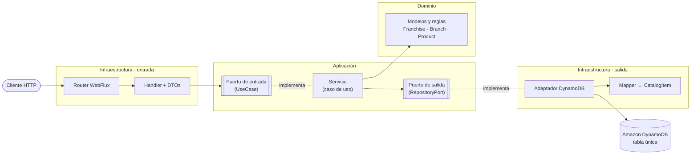

**Reglas que se respetan:**

- **Dominio** (`domain`): records inmutables con sus validaciones (nombre obligatorio, máximo 100 caracteres, stock nunca negativo). Sin anotaciones de frameworks.
- **Aplicación** (`application`): casos de uso y puertos (interfaces). Los servicios **no tienen anotaciones de Spring**; se registran como beans en una clase `*BeanConfig` de infraestructura.
- **Infraestructura** (`infrastructure`): todo lo que habla con el exterior. `in/web` (rutas, handlers, DTOs) y `out/persistence` (adaptadores DynamoDB).
- Un módulo usa a otro **solo a través de sus puertos** (por ejemplo, `AddBranchService` consulta `FranchiseRepositoryPort` para validar que la franquicia exista).

### Organización por funcionalidad

En lugar de una carpeta global por capa, cada funcionalidad tiene sus propias capas. Así cada módulo se entiende y se cambia de forma aislada.

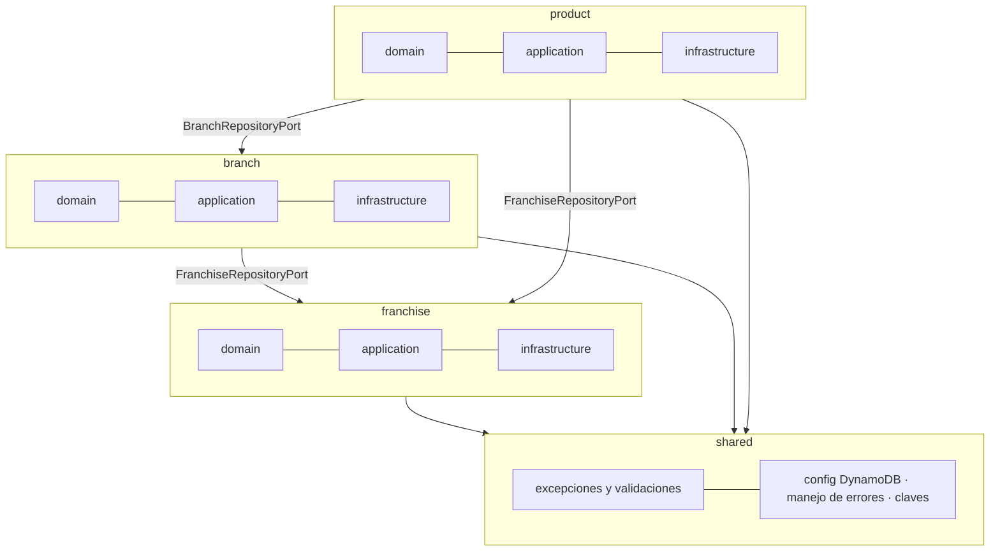

### Flujo de una petición (ejemplo: agregar producto)

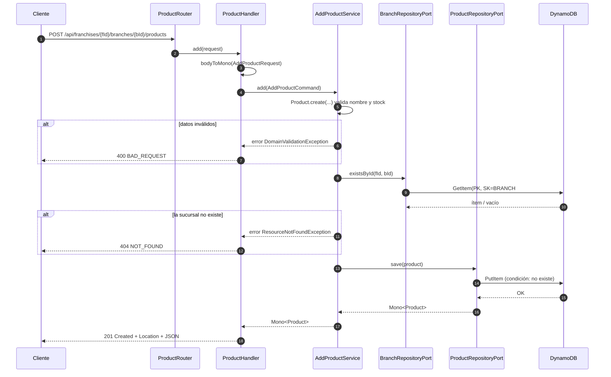

Todo el recorrido es **no bloqueante**: cada paso devuelve `Mono`/`Flux` y el cliente de DynamoDB es asíncrono.

### Manejo de errores

Las excepciones se traducen en un único lugar (`ApiErrorResponses.withErrorHandling`) y todas las respuestas de error tienen el mismo formato:

| Excepción | HTTP | Ejemplo |
|---|---|---|
| `DomainValidationException` | 400 | Nombre vacío, stock negativo |
| `ServerWebInputException` | 400 | JSON mal formado |
| `ResourceNotFoundException` | 404 | Franquicia, sucursal o producto inexistente |

```json
{ "code": "NOT_FOUND", "message": "La franquicia 7d1c... no existe" }
```

---

## Estructura del proyecto

```text
src/main/java/com/acenture/prueba_tecnica
├── franchise
│   ├── domain/model/                 Franchise
│   ├── application
│   │   ├── port/in/                  CreateFranchiseUseCase, RenameFranchiseUseCase
│   │   ├── port/out/                 FranchiseRepositoryPort
│   │   └── service/                  CreateFranchiseService, RenameFranchiseService
│   └── infrastructure
│       ├── config/                   FranchiseBeanConfig
│       ├── in/web/                   FranchiseRouter, FranchiseHandler, dto/
│       └── out/persistence/          FranchiseDynamoDbAdapter, FranchiseItemMapper
├── branch                            (misma estructura) AddBranch, RenameBranch
├── product                           (misma estructura) AddProduct, DeleteProduct,
│                                     UpdateProductStock, RenameProduct, GetTopStockProducts
└── shared
    ├── domain/exception/             DomainValidationException, ResourceNotFoundException
    ├── domain/validation/            Validations
    └── infrastructure
        ├── config/                   DynamoDbConfig, DynamoDbProperties
        ├── persistence/              CatalogItem, DynamoDbKeys, DynamoDbQueries
        └── web/                      ApiErrorResponses, ErrorResponse, dto/RenameRequest

src/main/resources
├── application.properties
└── static/openapi.yaml               Contrato OpenAPI 3

infra/                                Terraform: tabla DynamoDB + usuario IAM de la app
Dockerfile                            Imagen en dos etapas (compila + JRE liviano)
docker-compose.yml                    DynamoDB Local + creación de tabla + API
```

---

## Modelo de datos en DynamoDB

### Modelo de dominio

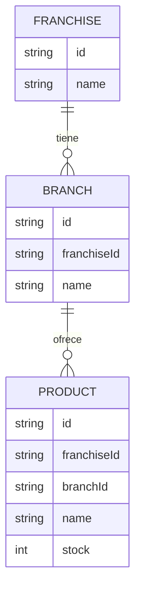

### Diseño de tabla única (single-table design)

Todo lo de una franquicia vive en **la misma partición** (`PK`). La clave de ordenamiento (`SK`) indica qué es cada ítem y refleja la jerarquía:

| Entidad | PK | SK | Atributos |
|---|---|---|---|
| Franquicia | `FRANCHISE#{franchiseId}` | `METADATA` | `entityType=FRANCHISE`, `name` |
| Sucursal | `FRANCHISE#{franchiseId}` | `BRANCH#{branchId}` | `entityType=BRANCH`, `name` |
| Producto | `FRANCHISE#{franchiseId}` | `BRANCH#{branchId}#PRODUCT#{productId}` | `entityType=PRODUCT`, `name`, `stock` |

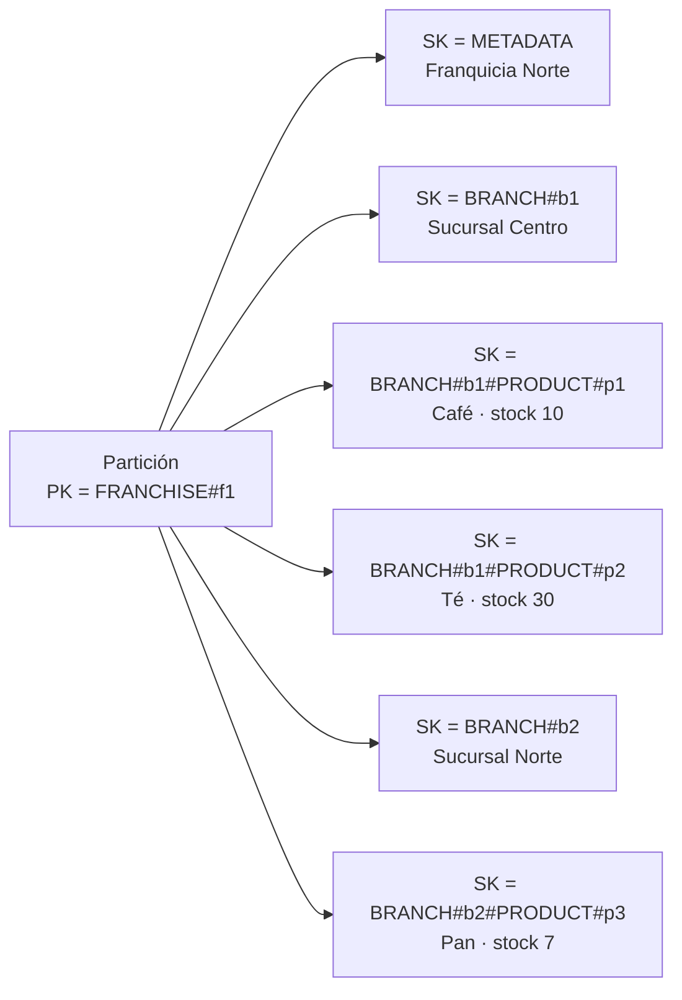

**Patrones de acceso que resuelve:**

| Necesidad | Operación |
|---|---|
| Leer o validar una franquicia | `GetItem(PK, SK=METADATA)` |
| Leer o validar una sucursal | `GetItem(PK, SK=BRANCH#id)` |
| Leer, actualizar o eliminar un producto | `GetItem` / `PutItem` / `DeleteItem` con `SK=BRANCH#id#PRODUCT#id` |
| Todas las sucursales y productos de una franquicia | **Una** `Query(PK, begins_with(SK, "BRANCH#"))` |

**Por qué este diseño:** el endpoint de “mayor stock por sucursal” necesita todas las sucursales y productos de una franquicia; con una sola partición eso es una consulta, sin `Scan` y sin uniones. Además, las escrituras usan condiciones (`attribute_not_exists` al crear, `attribute_exists` al actualizar) para no sobrescribir datos por accidente.

---

## Endpoints

Base: `http://localhost:8080`

| # | Método | Ruta | Descripción | Respuesta |
|---|---|---|---|---|
| 1 | `POST` | `/api/franchises` | Crear franquicia | `201` |
| 2 | `POST` | `/api/franchises/{franchiseId}/branches` | Agregar sucursal | `201` |
| 3 | `POST` | `/api/franchises/{franchiseId}/branches/{branchId}/products` | Agregar producto | `201` |
| 4 | `DELETE` | `/api/franchises/{franchiseId}/branches/{branchId}/products/{productId}` | Eliminar producto | `204` |
| 5 | `PATCH` | `/api/franchises/{franchiseId}/branches/{branchId}/products/{productId}/stock` | Modificar stock | `200` |
| 6 | `GET` | `/api/franchises/{franchiseId}/top-stock-products` | Producto con más stock por sucursal | `200` |
| Extra | `PATCH` | `/api/franchises/{franchiseId}/name` | Cambiar nombre de la franquicia | `200` |
| Extra | `PATCH` | `/api/franchises/{franchiseId}/branches/{branchId}/name` | Cambiar nombre de la sucursal | `200` |
| Extra | `PATCH` | `/api/franchises/{franchiseId}/branches/{branchId}/products/{productId}/name` | Cambiar nombre del producto | `200` |

### Ejemplos con `curl`

```bash
# 1. Crear franquicia
curl -X POST http://localhost:8080/api/franchises \
  -H "Content-Type: application/json" \
  -d '{"name":"Franquicia Norte"}'
# -> 201 {"id":"<franchiseId>","name":"Franquicia Norte"}

# 2. Agregar sucursal
curl -X POST http://localhost:8080/api/franchises/<franchiseId>/branches \
  -H "Content-Type: application/json" \
  -d '{"name":"Sucursal Centro"}'

# 3. Agregar producto
curl -X POST http://localhost:8080/api/franchises/<franchiseId>/branches/<branchId>/products \
  -H "Content-Type: application/json" \
  -d '{"name":"Café","stock":25}'

# 4. Eliminar producto
curl -X DELETE http://localhost:8080/api/franchises/<franchiseId>/branches/<branchId>/products/<productId>

# 5. Modificar stock
curl -X PATCH http://localhost:8080/api/franchises/<franchiseId>/branches/<branchId>/products/<productId>/stock \
  -H "Content-Type: application/json" \
  -d '{"stock":40}'

# 6. Producto con más stock por sucursal
curl http://localhost:8080/api/franchises/<franchiseId>/top-stock-products
```

Respuesta del endpoint 6:

```json
[
  { "branchId": "b1", "branchName": "Sucursal Centro", "productId": "p2", "productName": "Té",  "stock": 30 },
  { "branchId": "b2", "branchName": "Sucursal Norte",  "productId": "p3", "productName": "Pan", "stock": 7 }
]
```

---

## Reglas de negocio y decisiones de diseño

**Validaciones del dominio**

- Los nombres son obligatorios, se recortan los espacios y tienen máximo 100 caracteres.
- El stock es obligatorio y nunca puede ser negativo (0 sí es válido).
- Se valida **antes** de consultar la base de datos: una petición inválida no genera lecturas en DynamoDB.
- Los ids se generan en el dominio (UUID).

**Producto con más stock por sucursal** (`GetTopStockProductsService`)

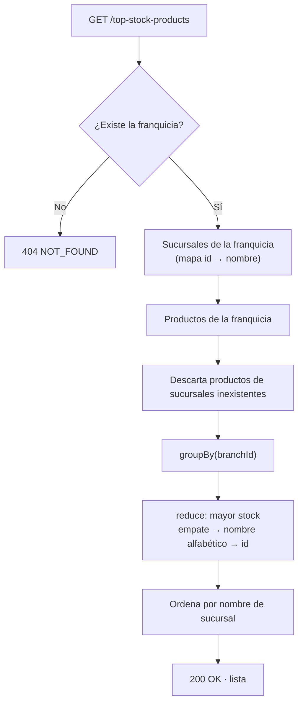

- Devuelve **un producto por sucursal**, indicando a qué sucursal pertenece.
- Las sucursales **sin productos no aparecen**.
- **Empate** en stock: gana el producto con nombre alfabéticamente menor (y luego el id), para que el resultado sea siempre el mismo.
- El resultado se ordena por nombre de sucursal.
- El cálculo se hace con operadores reactivos (`groupBy` + `reduce`) sin bloquear.

**Otras decisiones**

| Decisión | Motivo |
|---|---|
| Rutas funcionales (`RouterFunction`) en vez de `@RestController` | Estilo idiomático de WebFlux; separa ruteo y lógica del handler. |
| Empaquetado JAR (no WAR) | Netty embebido; pensado para contenedores. |
| Contrato OpenAPI escrito a mano (contract-first) | springdoc no detecta rutas funcionales sin llenar la capa web de anotaciones. |
| Crear devuelve `201` + `Location`; eliminar devuelve `204` | Semántica HTTP estándar. |
| `PATCH` para cambios parciales (stock, nombre) | Solo se modifica un campo del recurso. |
| Errores de lista: se junta la lista antes de responder | Así un 404 se devuelve bien en vez de cortar una respuesta ya iniciada. |

---

## Cómo ejecutar en local

### Opción recomendada — Docker Compose (un solo comando)

Solo requiere **Docker**. No necesita Java, Maven ni cuenta de AWS.

```bash
docker compose up --build
```

Esto levanta tres servicios:

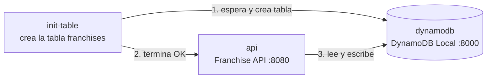

- API: `http://localhost:8080`
- Swagger UI: `http://localhost:8080/swagger-ui.html`

La imagen de la API (`Dockerfile`) se construye en dos etapas: la primera compila **y ejecuta las pruebas unitarias** con Maven; la segunda copia solo el JAR sobre una imagen `eclipse-temurin:21-jre-alpine` y lo ejecuta con un usuario sin privilegios.

Para detener todo: `docker compose down`.

### Requisitos para ejecutar sin Docker

- **JDK 21** (por ejemplo, Eclipse Temurin) con `JAVA_HOME` configurado.
- Una tabla de DynamoDB: en AWS o con **DynamoDB Local**.
- No hace falta instalar Maven: el proyecto incluye el wrapper (`mvnw` / `mvnw.cmd`).

### Variables de configuración

| Variable | Valor por defecto | Descripción |
|---|---|---|
| `DYNAMODB_TABLE` | `franchises` | Nombre de la tabla |
| `AWS_REGION` | `us-east-2` | Región de AWS |
| `DYNAMODB_ENDPOINT` | *(vacío)* | URL de DynamoDB Local; vacío = AWS real |
| `AWS_PROFILE` | — | Perfil de credenciales de AWS (solo contra AWS real) |

Las credenciales se toman de la cadena estándar del SDK de AWS (variables de entorno, perfil, `aws login`, rol IAM). **Nunca se guardan en el repositorio.**

### Opción A — DynamoDB Local sin Docker Compose

```bash
# 1. Levantar DynamoDB Local
docker run -d --name dynamodb-local -p 8000:8000 amazon/dynamodb-local

# 2. Crear la tabla (las credenciales pueden ser falsas para DynamoDB Local)
AWS_ACCESS_KEY_ID=local AWS_SECRET_ACCESS_KEY=local \
aws dynamodb create-table \
  --endpoint-url http://localhost:8000 --region us-east-2 \
  --table-name franchises \
  --attribute-definitions AttributeName=PK,AttributeType=S AttributeName=SK,AttributeType=S \
  --key-schema AttributeName=PK,KeyType=HASH AttributeName=SK,KeyType=RANGE \
  --billing-mode PAY_PER_REQUEST

# 3. Arrancar la API apuntando a DynamoDB Local
DYNAMODB_ENDPOINT=http://localhost:8000 \
AWS_ACCESS_KEY_ID=local AWS_SECRET_ACCESS_KEY=local \
./mvnw spring-boot:run
```

En **Windows (PowerShell)**:

```powershell
$env:DYNAMODB_ENDPOINT = "http://localhost:8000"
$env:AWS_ACCESS_KEY_ID = "local"
$env:AWS_SECRET_ACCESS_KEY = "local"
.\mvnw.cmd spring-boot:run
```

### Opción B — DynamoDB en AWS

1. Crea la tabla con Terraform (ver [Infraestructura como código](#infraestructura-como-código-terraform)).
2. Arranca la API con tus credenciales o con las del usuario creado por Terraform:

```bash
AWS_PROFILE=<tu-perfil> AWS_REGION=us-east-2 ./mvnw spring-boot:run
```

### Generar y ejecutar el JAR

```bash
./mvnw clean package
java -jar target/demo-0.0.1-SNAPSHOT.jar
```

La API queda disponible en `http://localhost:8080`.

---

## Arquitectura en AWS

Toda la solución corre en **AWS, región `us-east-2` (Ohio)**, y se crea con Terraform (`infra/`).

| Servicio | Uso |
|---|---|
| **Amazon EC2** (`t3.micro`, Amazon Linux 2023) | Servidor donde corre el contenedor Docker de la API |
| **Amazon DynamoDB** | Base de datos: tabla única `franchises` |
| **AWS IAM** | Rol de la instancia con permisos mínimos sobre la tabla |
| **Amazon VPC** | VPC por defecto, subred pública y Security Group |
| **AWS Systems Manager** (Session Manager) | Acceso administrativo a la instancia sin SSH |

### Vista general

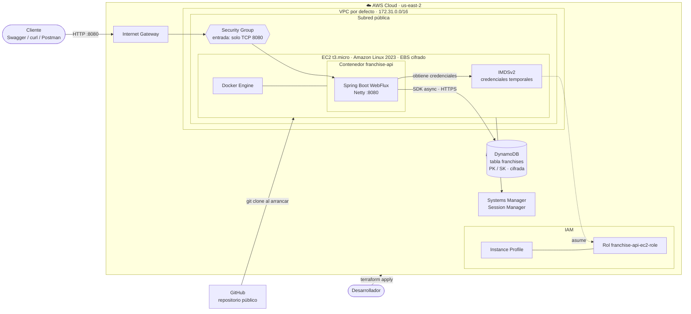

### Aprovisionamiento y despliegue

Con un solo `terraform apply` se crea la infraestructura y la instancia se despliega sola al arrancar (*user data*):

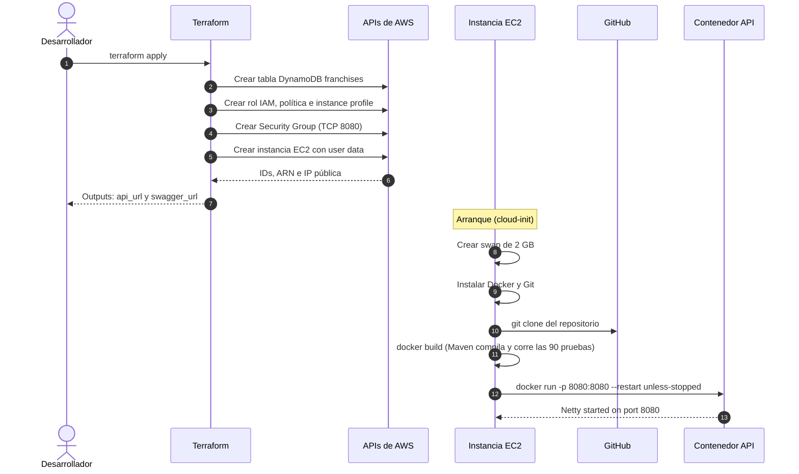

### Flujo de una petición en AWS

Ejemplo: `GET /api/franchises/{id}/top-stock-products`.

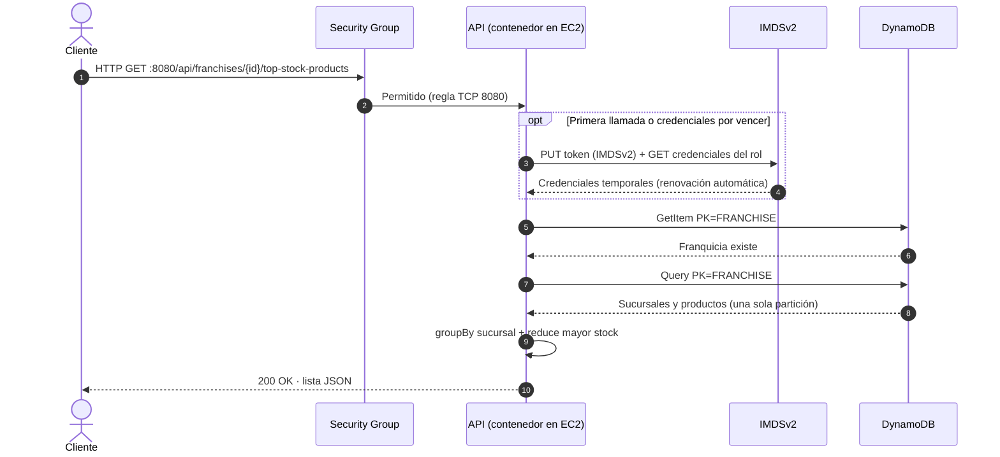

### Seguridad e IAM

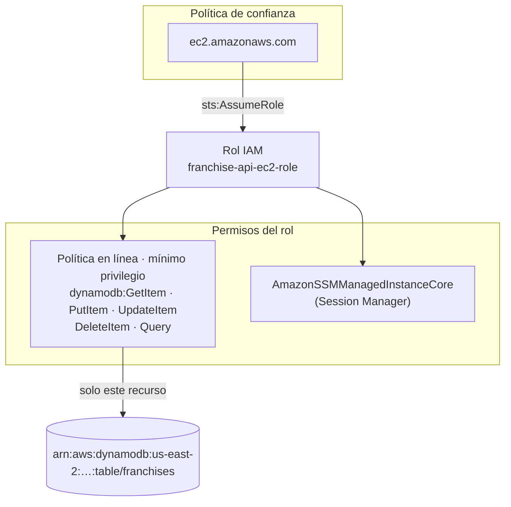

| Capa | Control |
|---|---|
| Credenciales | Sin claves de acceso en el código ni en el contenedor: rol IAM + credenciales temporales vía **IMDSv2** (obligatorio, `hop limit 2` para Docker) |
| Permisos | **Mínimo privilegio**: 5 acciones de DynamoDB sobre una sola tabla |
| Red | Security Group con solo el puerto `8080` abierto; **sin SSH** (administración por Session Manager) |
| Datos en reposo | Disco EBS cifrado y tabla DynamoDB con cifrado del lado del servidor |
| Repositorio | `terraform.tfstate` y `*.tfvars` excluidos en `.gitignore` |
| Contenedor | La API corre con un usuario sin privilegios dentro de la imagen |

### Costos

| Recurso | Costo estimado |
|---|---|
| DynamoDB (provisionado 5/5, &lt; 25 GB) | Dentro del nivel gratuito permanente de AWS |
| EC2 `t3.micro` + 20 GB gp3 | Unos USD 8–10 al mes (cubierto por créditos del plan gratuito) |
| IAM, Security Group, Session Manager | Sin costo |

Para eliminar todos los recursos: `terraform destroy` desde `infra/`.

---

## Infraestructura como código (Terraform)

La carpeta [`infra/`](infra) crea **toda la solución en AWS**: la base de datos y el servidor donde corre la API.

| Archivo | Recurso | Detalle |
|---|---|---|
| `main.tf` | `aws_dynamodb_table.franchises` | Tabla única con `PK` (hash) y `SK` (range), cifrada, modo provisionado 5/5 (nivel gratuito) |
| `compute.tf` | `aws_instance.api` | EC2 `t3.micro` con Amazon Linux 2023; al arrancar instala Docker, clona el repositorio, construye la imagen y ejecuta la API |
| `compute.tf` | `aws_iam_role.api` + `aws_iam_instance_profile.api` | Rol de la instancia con **mínimo privilegio**: solo `GetItem`, `PutItem`, `UpdateItem`, `DeleteItem` y `Query` sobre la tabla |
| `compute.tf` | `aws_security_group.api` | Solo el puerto `8080` abierto (configurable con `allowed_cidr`); sin SSH |
| `main.tf` | `aws_iam_user.app` (opcional) | Usuario con clave de acceso, solo si la API se ejecuta **fuera** de AWS (`create_app_user=true`) |

Los diagramas de la infraestructura resultante están en [Arquitectura en AWS](#arquitectura-en-aws).

**Seguridad:** la API **no usa claves de acceso** en AWS. La instancia tiene un rol IAM y el SDK obtiene credenciales temporales automáticamente (IMDSv2 obligatorio). El disco está cifrado y no hay puerto SSH abierto; para entrar a la instancia se usa Session Manager.

### Aplicar

Requiere [Terraform](https://developer.hashicorp.com/terraform/install) ≥ 1.6 y credenciales de AWS.

```bash
cd infra
terraform init
terraform plan
terraform apply
```

Al terminar, Terraform muestra la URL de la API:

```text
api_url     = "http://<ip-publica>:8080"
swagger_url = "http://<ip-publica>:8080/swagger-ui.html"
```

La instancia tarda unos minutos en estar lista después del `apply`, porque compila el proyecto y ejecuta las pruebas dentro de Docker. El progreso queda en `/var/log/cloud-init-output.log` (visible desde Session Manager).

Variables principales (`variables.tf`):

| Variable | Por defecto | Descripción |
|---|---|---|
| `aws_region` | `us-east-2` | Región |
| `table_name` | `franchises` | Nombre de la tabla |
| `read_capacity` / `write_capacity` | `5` | Capacidad provisionada |
| `instance_type` | `t3.micro` | Tamaño del servidor |
| `repo_url` / `repo_branch` | este repositorio / `main` | Código que se despliega |
| `allowed_cidr` | `0.0.0.0/0` | Quién puede acceder a la API |
| `create_app_user` | `false` | Crea usuario IAM con clave para correr la API fuera de AWS |

> **Seguridad:** el estado de Terraform (`terraform.tfstate`) está en `.gitignore` y nunca se sube al repositorio.

Para eliminar todo: `terraform destroy`.

---

## Pruebas

```bash
./mvnw test          # Linux / macOS
.\mvnw.cmd test      # Windows
```

Las pruebas son **unitarias** y no necesitan AWS ni DynamoDB (los puertos se reemplazan con mocks).

**Cobertura:** al ejecutar las pruebas, JaCoCo genera el reporte en `target/site/jacoco/index.html`.

| Capa | Herramientas | Qué se prueba |
|---|---|---|
| Dominio | JUnit 5, AssertJ | Validaciones de `Franchise` y `Product` |
| Casos de uso | Mockito, `StepVerifier` | Lógica de cada servicio: éxito, 404, validaciones, errores del repositorio, que no se consulte la base si los datos son inválidos |
| Web | `WebTestClient` | Códigos HTTP, cuerpo JSON, encabezado `Location`, formato de errores, JSON inválido |

Cobertura por endpoint:

| Endpoint | Pruebas |
|---|---|
| Crear franquicia | 8 (+4 del modelo) |
| Agregar sucursal | 9 |
| Agregar producto | 9 (+3 del modelo) |
| Eliminar producto | 9 |
| Modificar stock | 10 |
| Producto con más stock | 11 |
| Renombrar franquicia | 8 |
| Renombrar sucursal | 8 |
| Renombrar producto | 8 |

**Resultado:** `Tests run: 90, Failures: 0, Errors: 0, Skipped: 0` — **BUILD SUCCESS**. El total incluye las ejecuciones de las pruebas parametrizadas y la prueba de arranque del contexto de Spring (`DemoApplicationTests`).

---

## Documentación OpenAPI

- **Swagger UI:** `http://localhost:8080/swagger-ui.html`
- **Contrato:** `http://localhost:8080/openapi.yaml` (archivo `src/main/resources/static/openapi.yaml`)

El contrato documenta los 9 endpoints con sus parámetros, cuerpos, respuestas (201/200/204/400/404) y ejemplos.

---

## Flujo de trabajo con Git

- Rama principal: `main`.
- Commits pequeños, uno por funcionalidad, con mensajes en formato **Conventional Commits** (`feat:`, `refactor:`, `test:`, `docs:`).

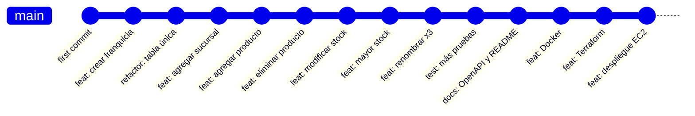

---

## Estado de los criterios de la prueba

| Criterio | Estado |
|---|---|
| Proyecto en Spring Boot | ✅ |
| Endpoints 1 a 6 (crear franquicia, sucursal, producto, eliminar, stock, mayor stock) | ✅ |
| Persistencia en la nube (DynamoDB) | ✅ Amazon DynamoDB (`us-east-2`), creada con Terraform |
| Programación reactiva | ✅ WebFlux + Reactor + cliente asíncrono de DynamoDB |
| Endpoints para cambiar nombres (franquicia, sucursal, producto) | ✅ |
| Pruebas unitarias | ✅ |
| Documentación (README + OpenAPI) | ✅ |
| Empaquetado con Docker | ✅ `Dockerfile` multi-etapa + `docker-compose.yml` |
| Infraestructura como código (Terraform) | ✅ `infra/` |
| Despliegue en la nube | ✅ API en EC2 + DynamoDB, todo en AWS y creado con Terraform |
